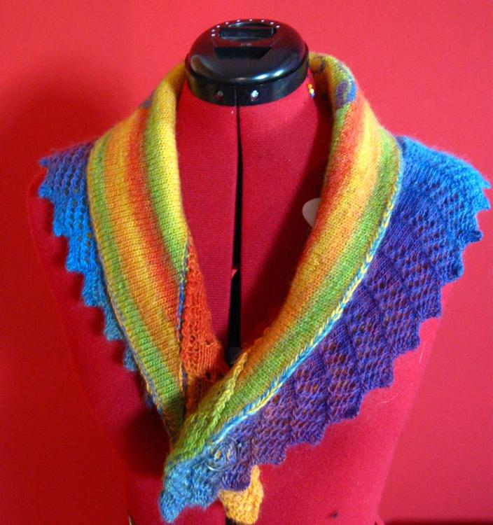
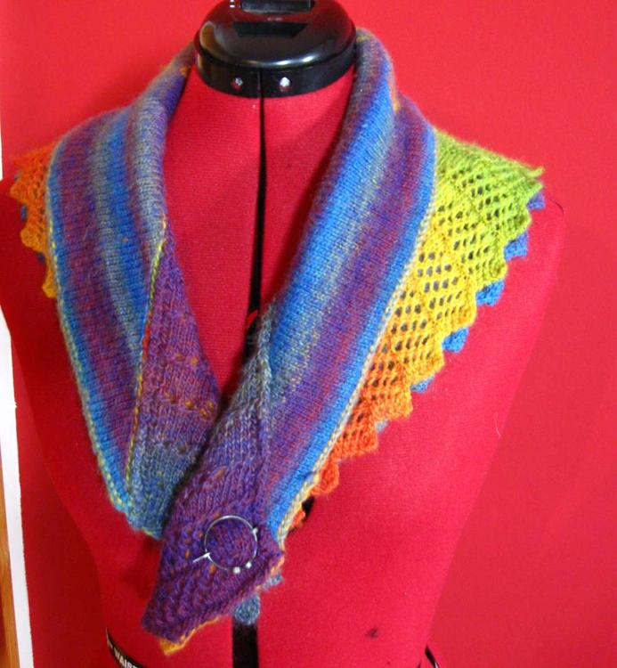
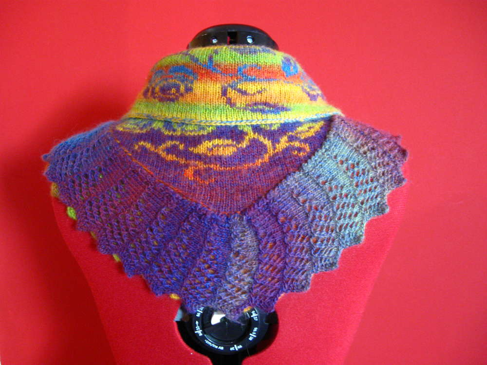
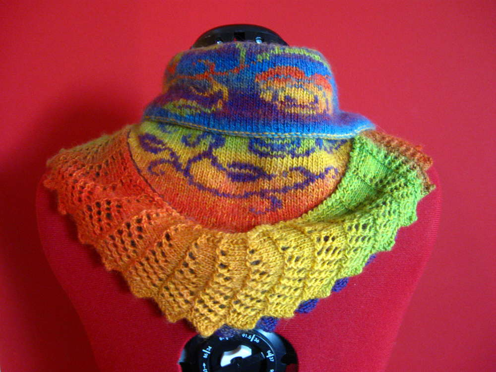
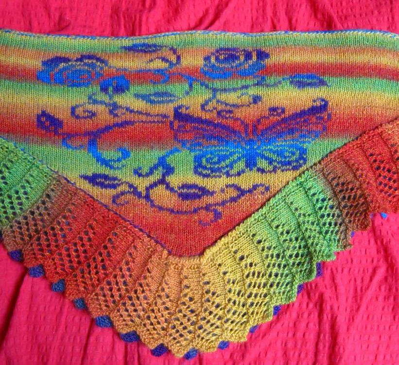
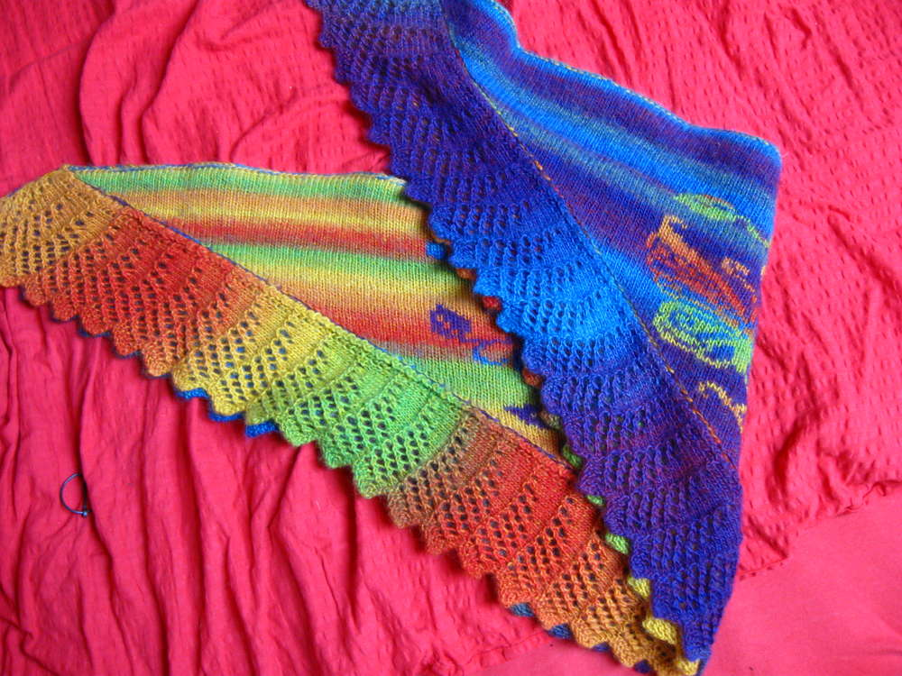
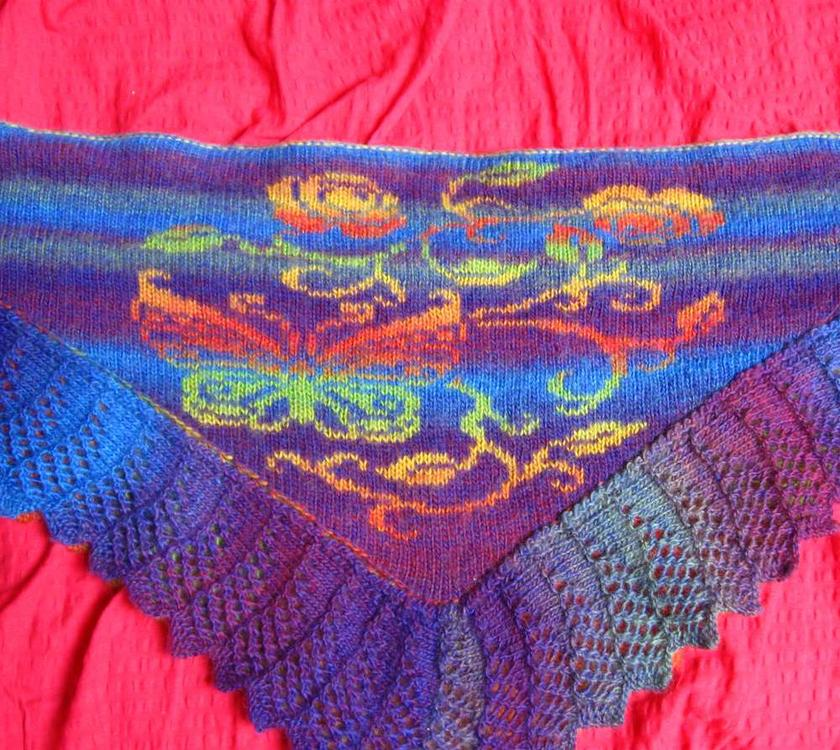

Ich finde ja wenn man Muster strickt, ist es doof, dass es auf der Rückseite des Strickstücks immer Fäden gibt, die die Rückseite mitunter unansehnlich machen oder an denen man sich verheddert...

Praktisch ist es, wenn man das Doppelstricken für sich entdeckt. Ich spare es mir hier eine Fotoanleitung zu machen, denn es gibt genug gute Anleitungen auf [Youtube](https://youtu.be/2yhfjOQeQl8?is=z-tem7kGOcBR-BMb), stattdessen sind hier ein paar Fotos von meinem ersten doppelt gestrickten Tuch. Wer die Strickspitze wiedererkennt - ja sie ist abgeschaut beim [In the Pink](/2014/01/in-the-pink/).

Das Muster habe ich mir selbst gebastelt mit dem tollsten Handarbeitsprogramm für den PC "Sticken bhv", unterschätzt diese unscheinbare kleine Zeitschriftenbeilage nicht. 

Du kannst quasi aus jedem Bild eine Stickschrift machen, zum Stricken musst du manche Bilder zuvor strecken, da Strickmaschen nicht gleich hoch wie breit sind.

Ich bekam die Software vor vielen Jahren in die Finger und wenn ihr das Glück habt da ran zu kommen und auch mit dem Doppelt-Stricken anfangen wollt, dann schützt sie wie euren Augapfel. Ich jedenfalls werde diese CD nie mehr rausrücken.

Wie ihr auf den Bildern sehen könnt, habe ich hier durch Fehler gelernt, dass Maschen nicht als Quadrate/Pixel wie beim Sticken betrachtet werden dürfen, da sie sich im Strickstück breiter als hoch verhalten und so das Bild gestaucht wird, wenn das Verhältnis zuvor nicht geändert wird.

Inzwischen gibt es auch viele andere handliche Apps, die dir aus einem Bild solche Vorlagen generieren können. Ich benutze für kleine Vorlagen "Stitchart".

Für dieses Tuch habe ich an der Spitze begonnen und am Rand immer in jeder Reihe (am Anfang die zweite Masche und am Ende die vorletzte Masche) verdoppelt und so wurde das Dreieckstuch immer breiter.

Zum Schluss wurde noch zweimal die Spitzenkante an die Randmaschen angestrickt und fertig ist das Wendetuch.
Es ist zwar klein aber mit einer Fibel lässt es sich kuschelig am Hals drapieren und hält dich dank der doppelten Strickschicht schön warm. 

Leg los und strick dir dein Wendetuch mit einem individuellen Design.