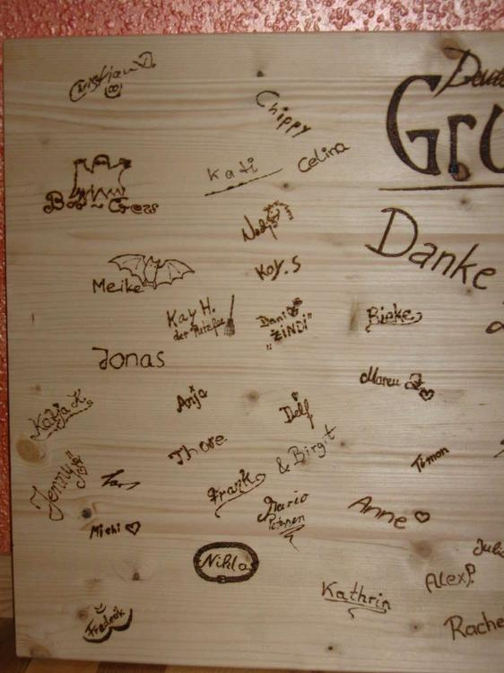
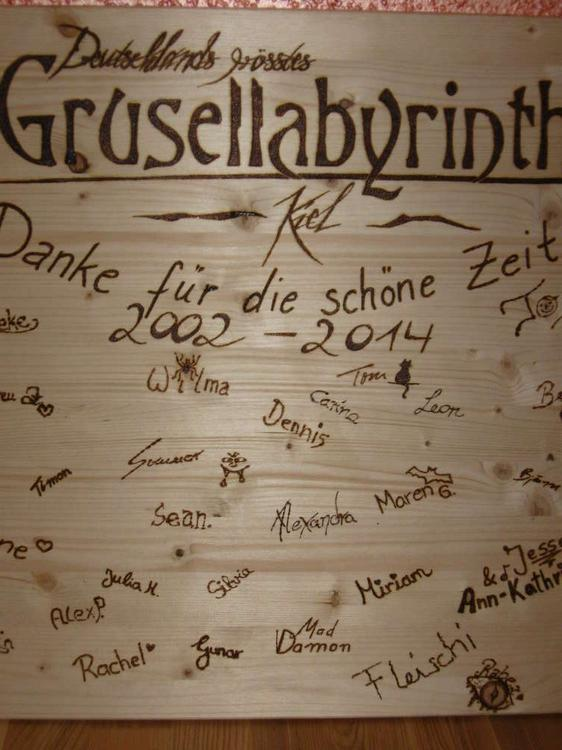
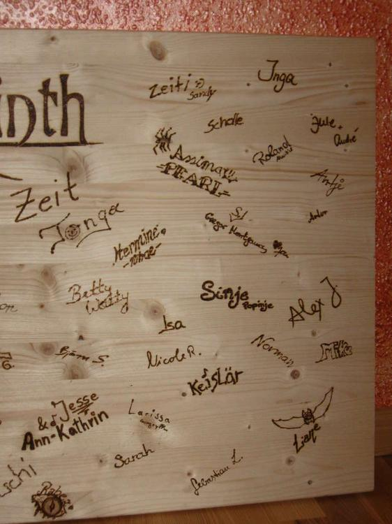
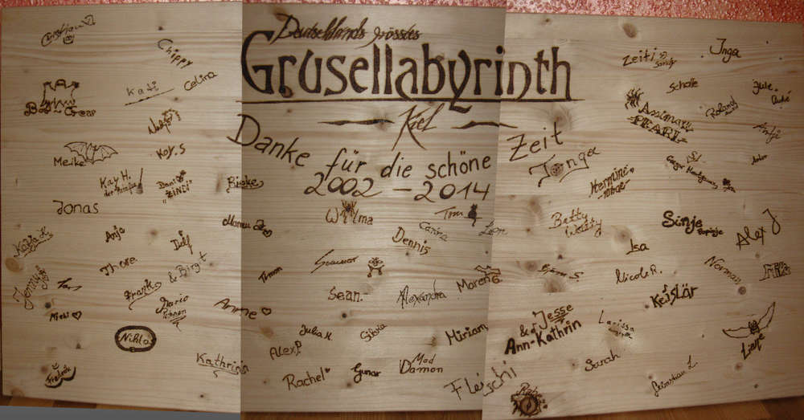

Nachdem ich trauriger Weise den Umzug meiner langjährigen Arbeitsstelle dulden musste, habe ich (als Andenken von uns Mitarbeitern für die Chefs) eine hölzerne Gedenktafel ins Leben gerufen.

Ich muss hier nicht schreiben für welche Attraktion ich mit viel Freude gearbeitet habe, das steht immerhin dick und fett drauf. 

Aufgrund der Überlänge, ist es aus drei Fotos zusammengeschnitten. Ich verabschiede mich von 5 Jahren, die mich tollen Menschen näher gebracht haben und auch den Spaß an der Arbeit nie haben vergessen lassen. 

Auch nach dem Umzug fühle ich mich als Teil dieser Attraktion, die ihre Zelte in Bottrop wieder aufgeschlagen hat und inzwischen ganz andere Wege gegangen ist. Das Leben geht weiter aber die schöne Erinnerung und wichtige Menschen können ja bleiben.

Remember, remember...

:D In diesem Sinne, Danke für die schöne Zeit. 13! Jawohl, jawohl! 
