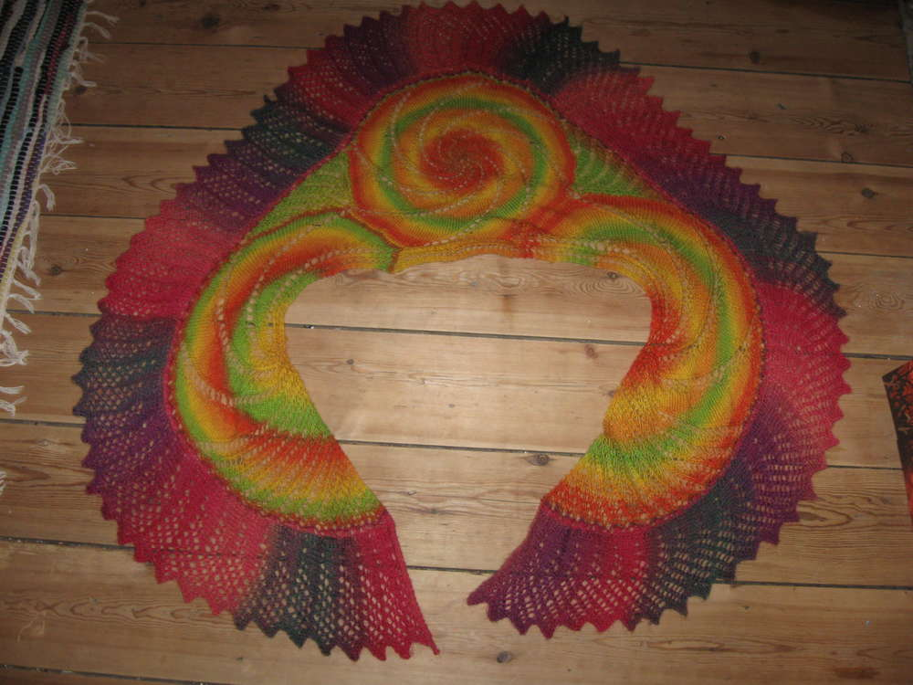
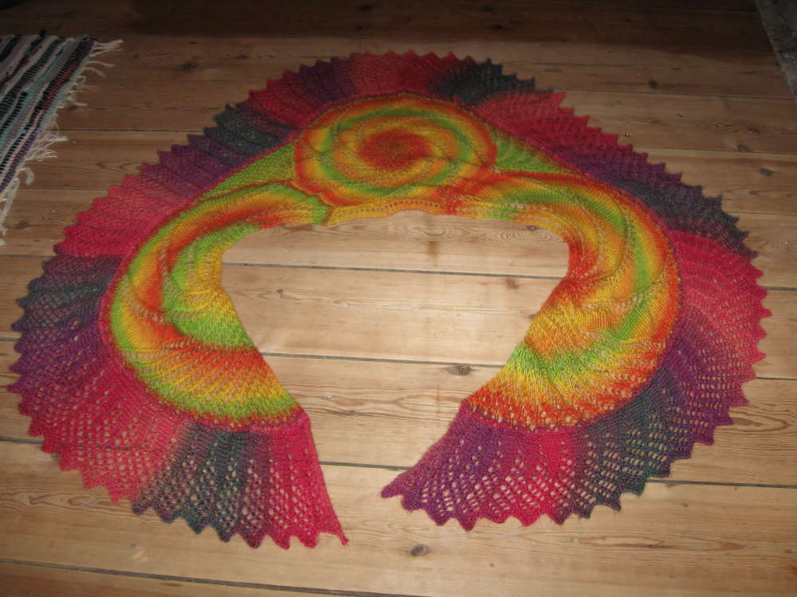
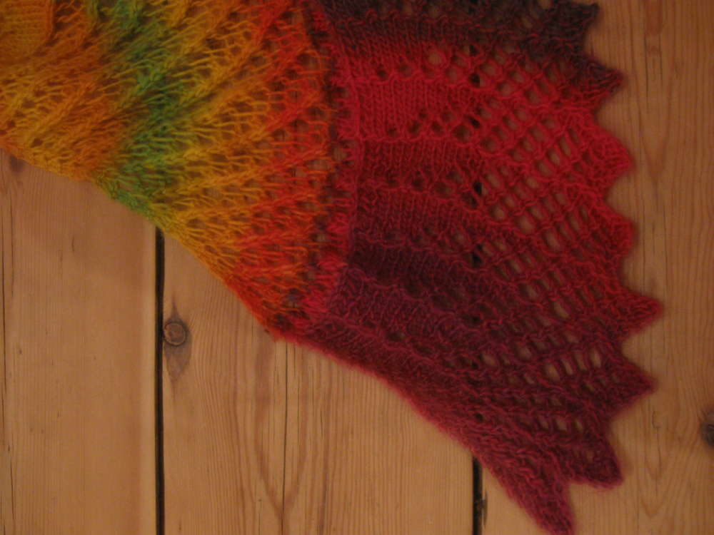
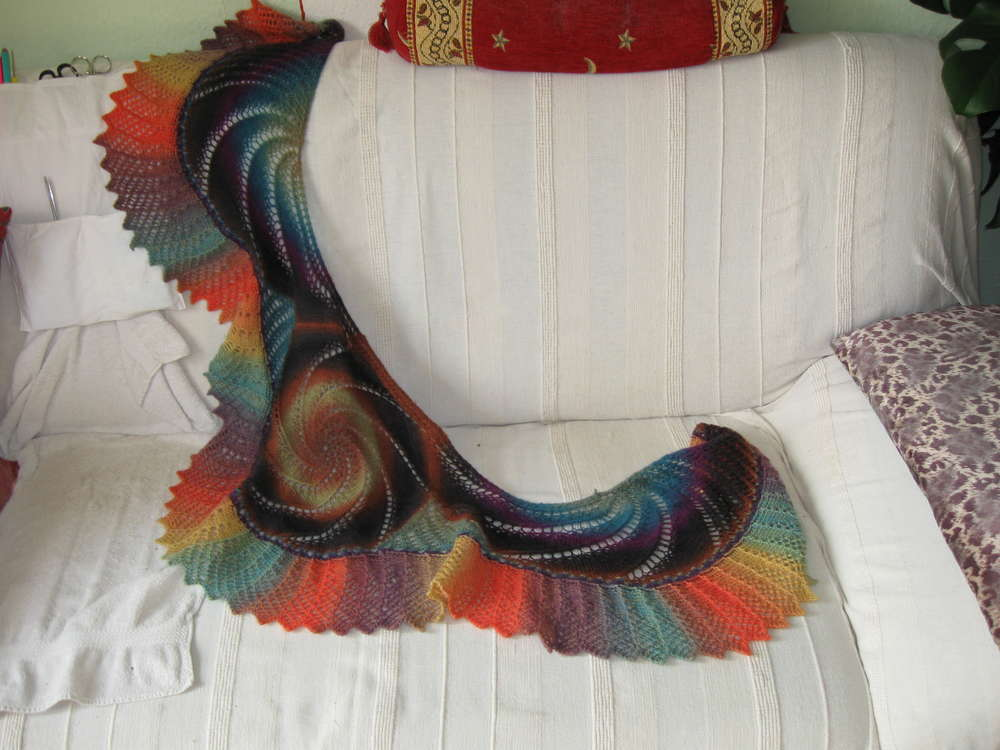
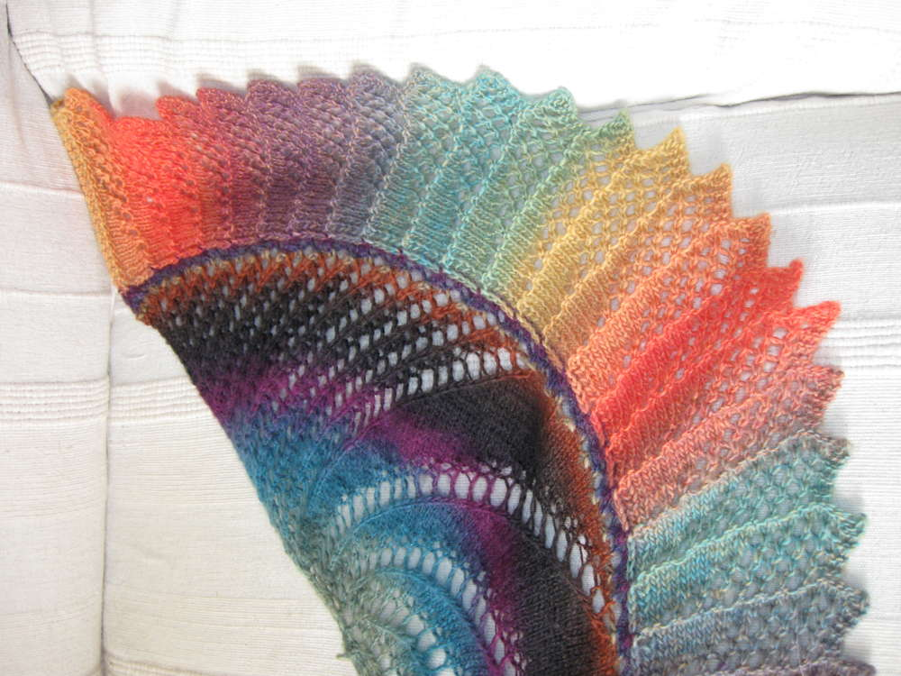
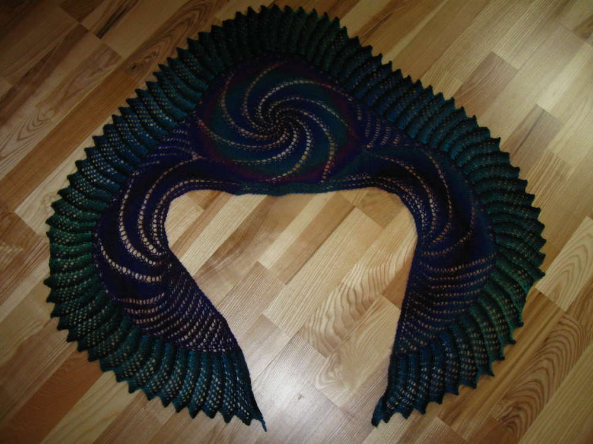
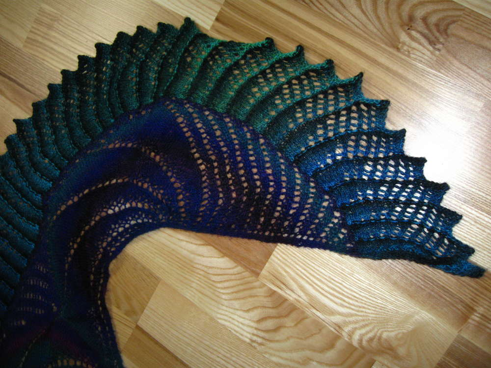
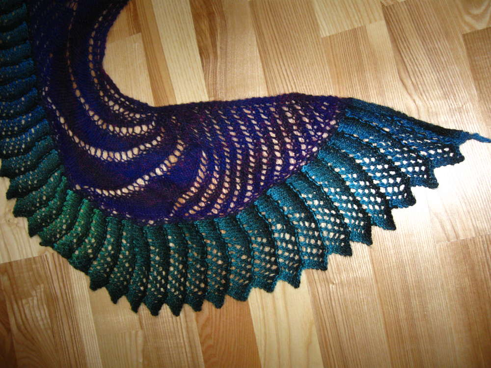
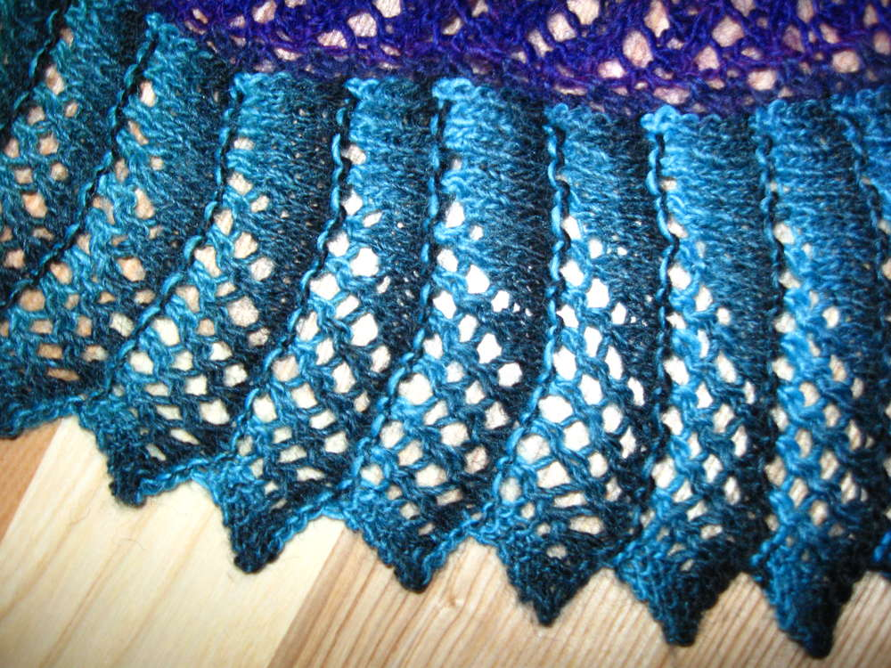
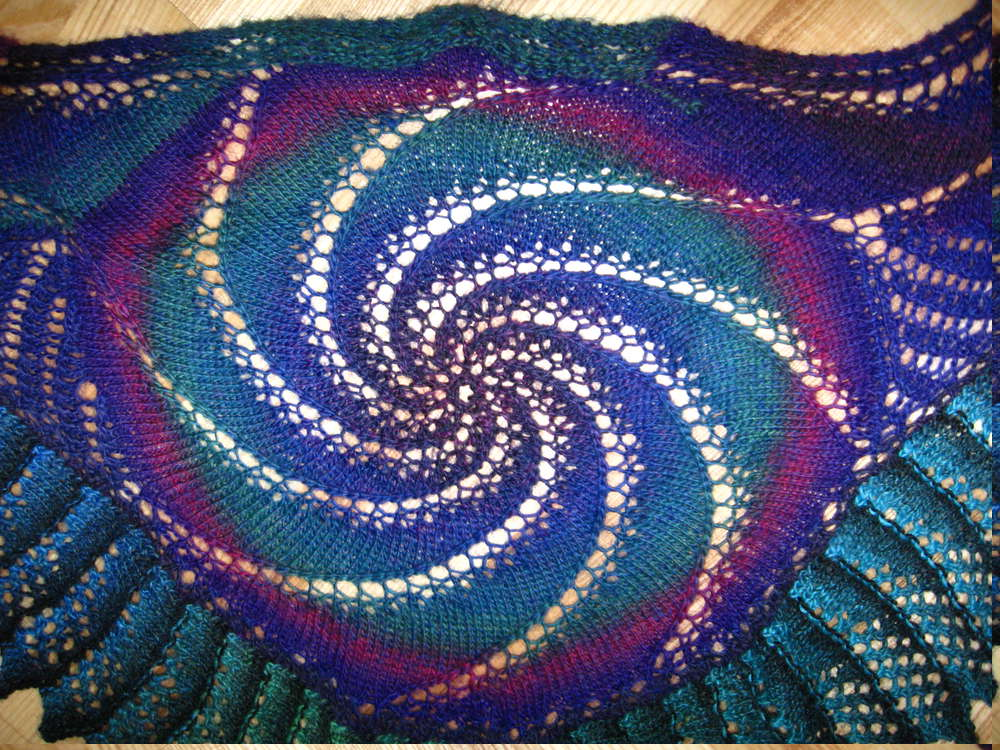

Hier zeige ich meinen Lieblingsschal nach einer Anleitung von [Ravelry](https://www.ravelry.com/account/login) in verschiedensten Ausführungen. Das war mein Erster "In the Pink" und der hat mich auch die meisten Nerven gekostet, denn die Anleitung ist auf Englisch und wenn du noch keine große Erfahrung mit englischen Strickbegriffen hast, kann das zu herausfordernden Situationen und so manchem Geribbel führen. du findest die Anleitung [hier](http://www.ravelry.com/patterns/library/in-the-pink-2). 

Trotzdem ist es der Schal mit dem man mich kennt, obwohl er zwei Fehler hat. Na, wer findet sie? Die Strickspitze vom Rand des Tuches habe ich auch schon bei anderen Tüchern verwendet zum Beispiel beim [Doubleface-Schal](/2014/01/doubleface/).

Dann habe ich noch in einer etwas gedeckteren Farbvariation für jemanden diesen In the Pink gestrickt.

Das war ein Weihnachtsgeschenk.

Als nächstes (ja das Strickmuster hat mich wirklich überzeugt) entstand dieser In the Pink mit lila blau und dunklen türkis Tönen.

Und auf den hatte ich einfach Lust, jetzt trage ich ihn zu besonderen Anlässen, weil er in etwas eleganteren Farben ist als mein erster Schal. Ich assoziiere hier auch Galaxienwirbel hinein. Mal schauen wie oft ich den Freund noch stricken werde. 
