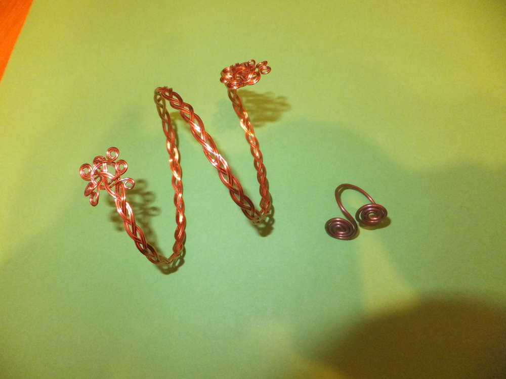
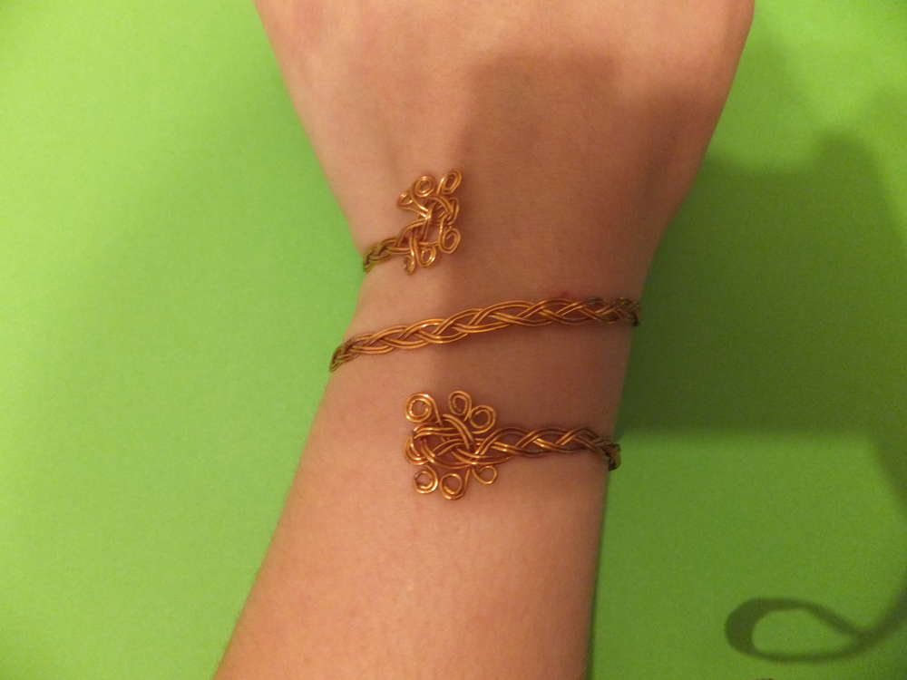
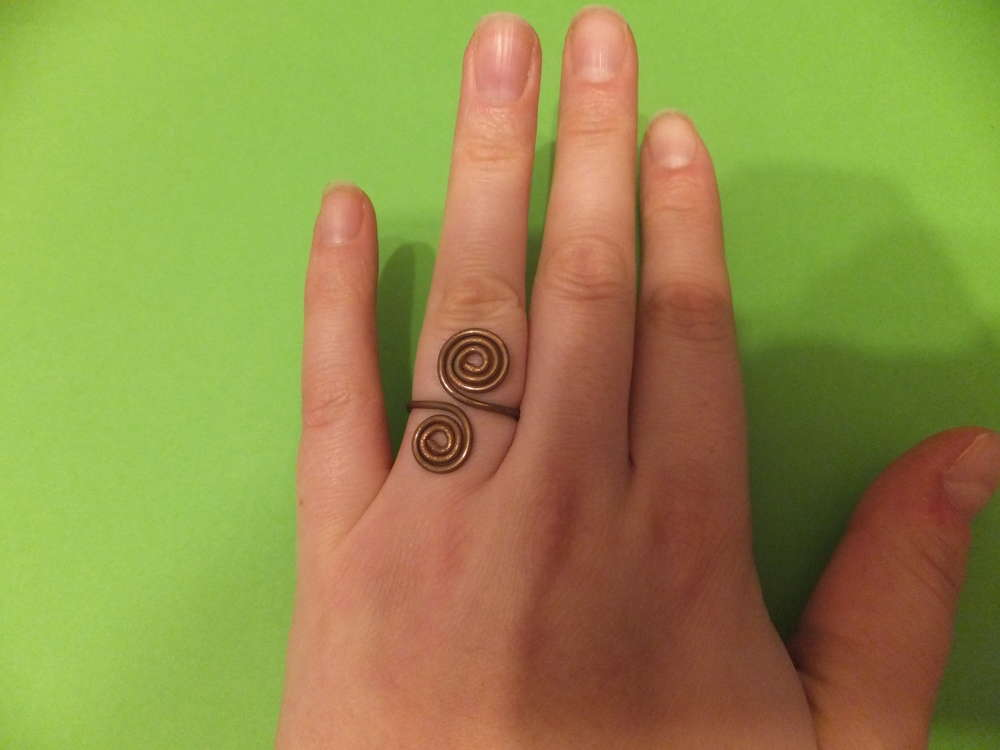

Also wer kennt das nicht: einem ist langweilig und zufällig liegen ein paar alte Kabel herum, die zu kurz zum... ähhh... verkabeln sind und sonst weggeworfen werden würden? 

Na nix wie ran an den Abisolierer und schön die Drähte verflechten... das kann sich sehen lassen. Mit der Rundzange die Enden verzwirbelt und Tadaa... schon ist aus etwas Unscheinbarem etwas Wunderbares geworden. Ein kleines Ringlein und ein Armband.

Der Ring ist aus dickeren Draht entstanden aber kann sich auch sehen lassen und besonders kurze Kabelreste kann man so auch einem neuen Zweck zuführen. 

