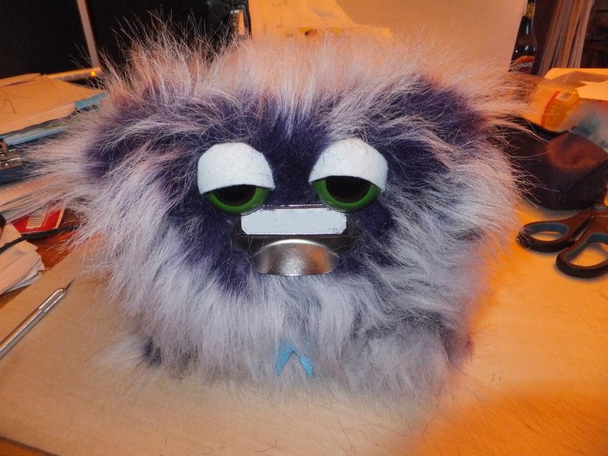
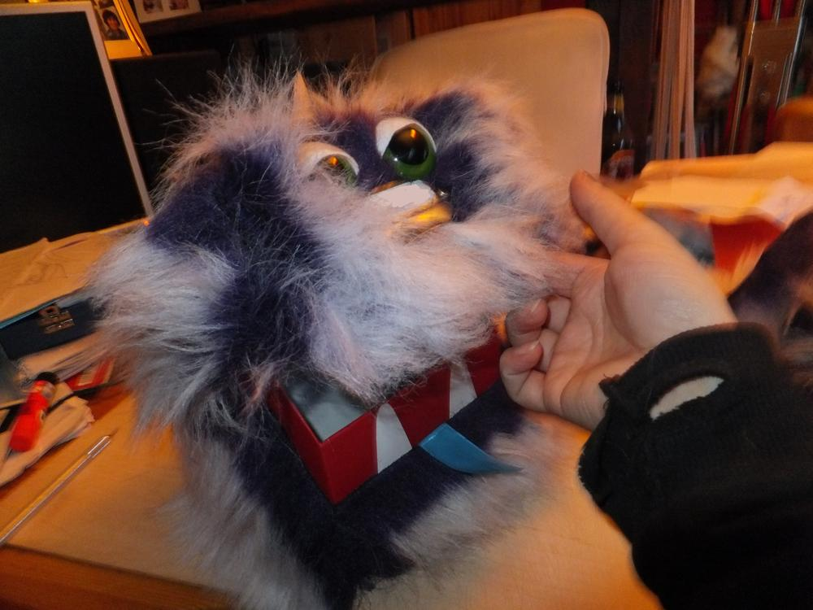
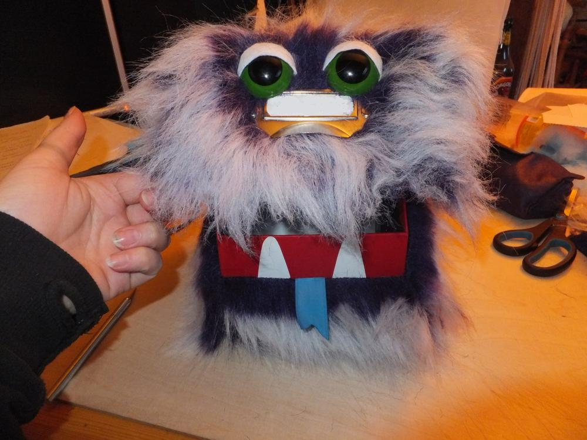
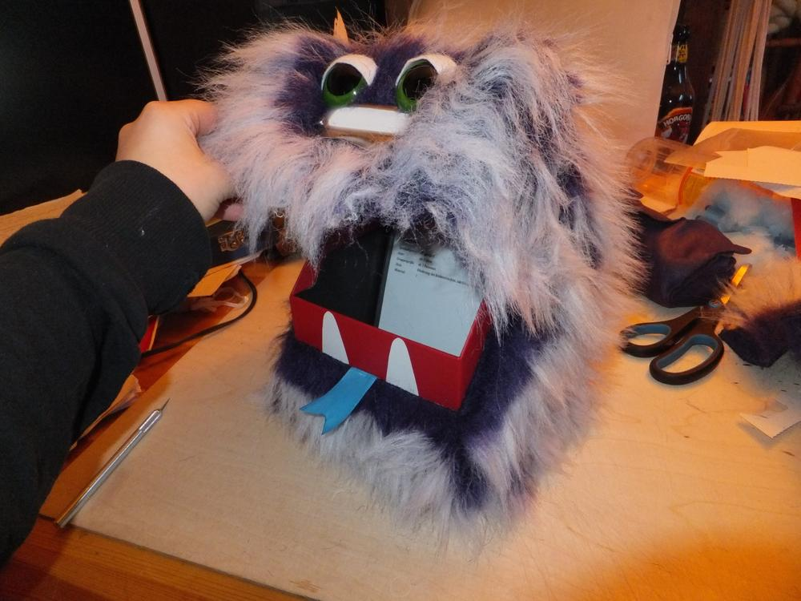

Also irgendwie fand ich den alten Karteikasten zu langweilig. 

Aber für meine Ausbildung als Erzieherin gehört es wohl unabdinglich dazu einen Karteikasten mit lauter einlaminierten Karteikarten voller Gruppenspiele besitzen zu müssen. 

Wenn ich ihn schon haben muss, dann gestalte ich ihn mir aber auch wie ich es will. ;)

Nach Karneval war der Flauschestoff im Angebot und ich hab mich daran gemacht den Karteikasten mit dem Stoff zu umkleben. Die Augen habe ich von alten Hauspuschen, die leider irgendwann kaputtgelaufen waren. Aber man wirft ja nichts weg. 

Das Beste von allem ist jedoch das Grußkarten-Sprachmodul, das ich mir gekauft habe. Da kann man eigene Soundaufnahmen abspielen, wenn der Lichtsensor durch öffnen des Deckels aktiviert wird. Nom Nom Nom.  
