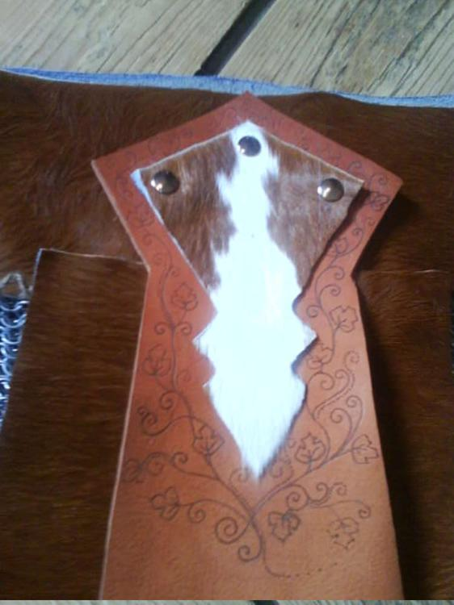
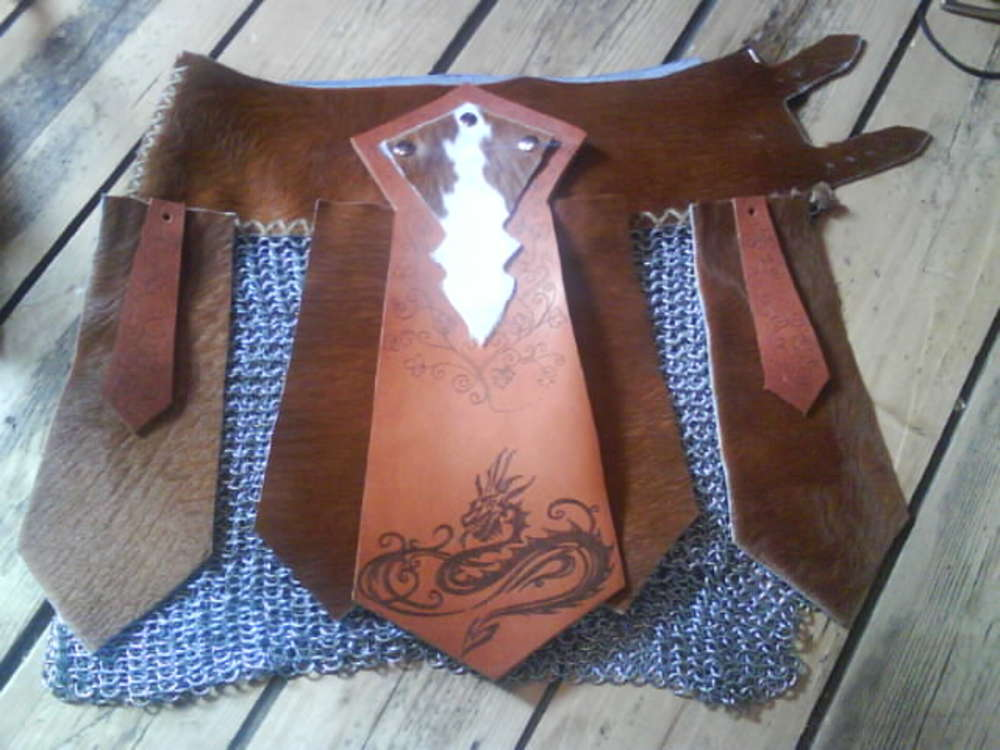
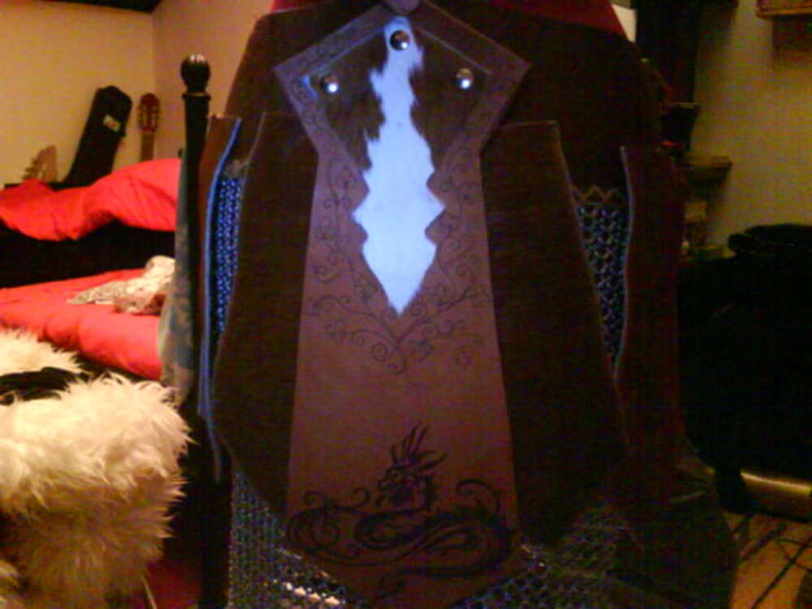

Eines meiner ersten Werkstücke, welches ziemlich viele verschiedene Arbeiten in sich vereint. 

Wofür braucht man sowas? Naja, der Rock sieht ziemlich genial aus und er rutscht nicht hoch, soviel kann ich verraten. 

Und wenn man sich einen kriegerischen Amazonen-Charakter bastelt fürs LARP, dann ist das eine angemessene Gewandung... ähh Rüstung für eine Frau. 

Wirklich getragen (außer zu Kostümparties) wird er nicht, er dient in erster Linie als Hingucker und ich hatte Lust so etwas zu machen. Man braucht ja nicht immer einen Nutzen für alles was man kreativ erschafft. ;)

Auf der Innenseite der Lederstreifen sind Schutzrunen eingebrannt. Bei diesem Projekt wurden Kettenringe verbunden, Leder genäht, vernietet und bebrannt. Hey was für ein Aufwand ;) Aber Spaß hat's gemacht. 

