Eine Secondhandjacke und Stoffreste können ein effektvolles Accessoire fürs perfekte herbstliche Halloweenoutfit sein. 

In diesem Fall geisterte mir schon länger die Idee einer orangefarbenen Kürbisjacke im Kopf herum und ich habe die Augen nach einer entsprechenden Jacke offen gehalten. Im Kiloladen habe ich dann endlich etwas akkurates für sagenhafte 4,50€ gefunden. Diese BlazerJacke ist aus unelastischem orangenem Samtstoff und ich mag den Schnitt sehr. Ein Paar Anpassungen müssen aber noch für das perfekte Herbstoutfit gemacht werden. 

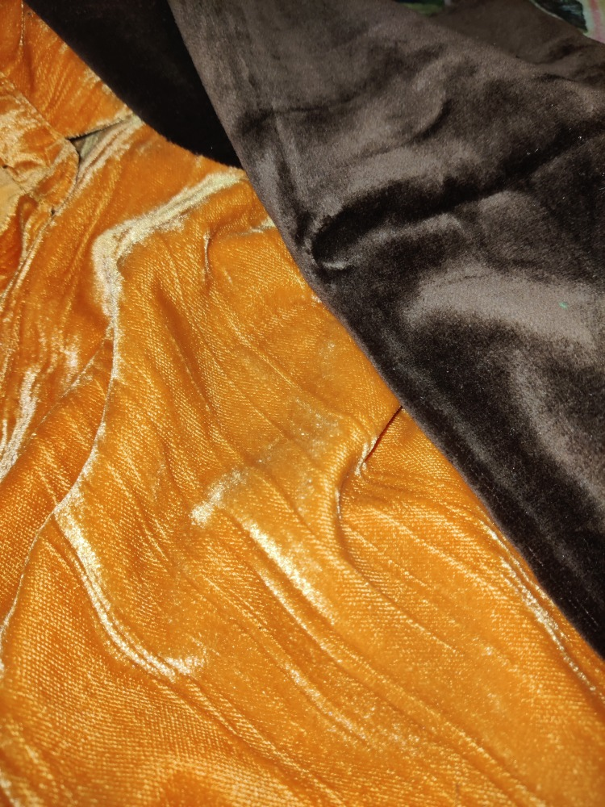

Ich habe in meinem Fundus noch einen schokobraunen Samtstoff gefunden mit diesem werde ich das Kürbisgesicht hinterlegen. Ursprünglich dachte ich an einen Lacestoff oder Spitze, aber ich hatte nichts passendes da und beim gleichen Material zu bleiben ist auch nicht verkehrt.

Also habe ich mich an das Gesichtsdesign gemacht und mir dann mit Kreide die Augen und den Mund auf die Rückseite des braunen Stoffes aufgemalt. 
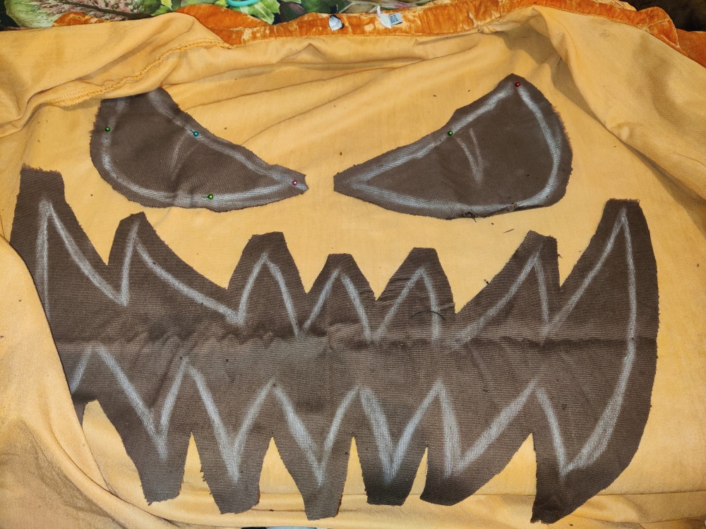

Dann wurden entlang der Kreidelinien die braunen Patches aufgesteppt. So kann ich gefahrlos den orangenen Stoff mit ca. 1 cm Abstand von der Naht ausschneiden.
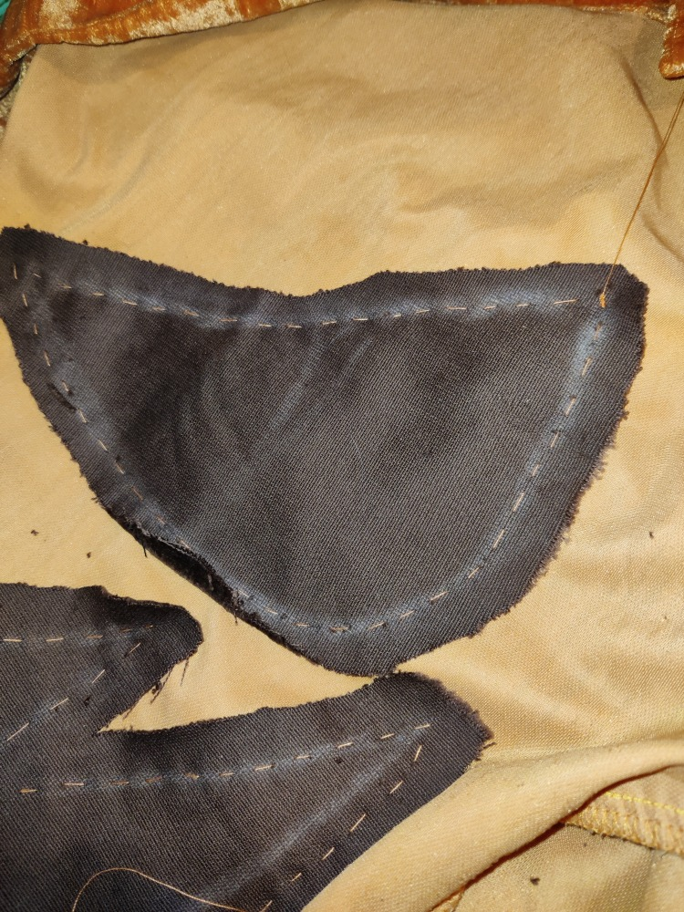

Als nächstes habe ich von Hand die Kanten nach Innen umgeschlagen und entlang der Naht umgenäht, so bekommt das Gesicht noch einen etwas plastischen Effekt. 

Nun war mir das noch nicht genug des Ganzen. Meine Jacke könnte noch charakteristische Blätter am Kragen haben, zum Glück beherbergte mein Fundus auch noch ein Paar Samtene Grüntöne, die ich perfekt als Reste verwerten kann für die Blätter und Ranken. 

Weil mir Kleidung immer besser steht, wenn sie auf der Taille endet, habe ich die Jacke noch abgeschnitten und ein Gummi in den unteren Saum eingenäht. So erhalte ich auch eine Raffung, die das bauchige Aussehen eines echten Kürbis imitiert. 

Und hier seht ihr nun mein fertiges Herbstliches Halloweenoutfit für den Alltag. 

Kürbistastische Grüße entsendet Eure Ermeline

## Anhänge

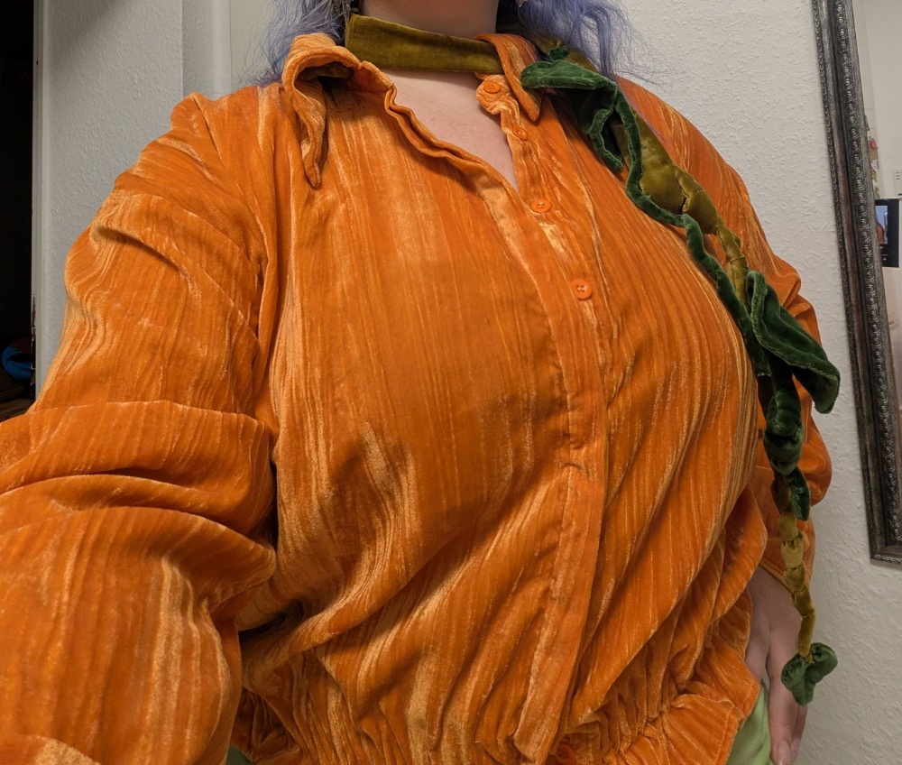
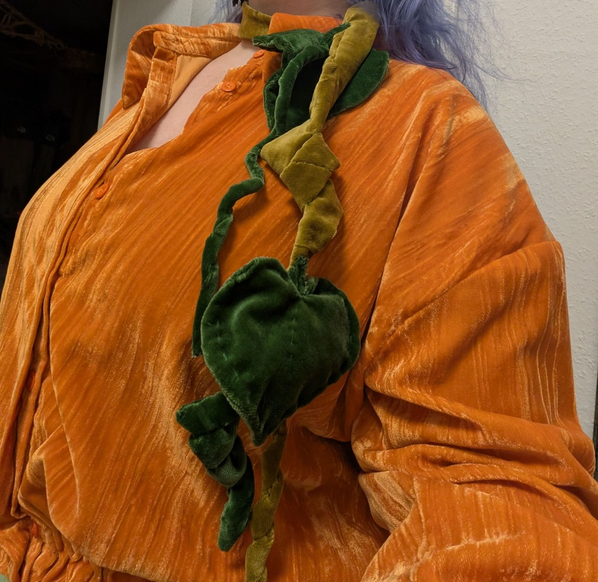
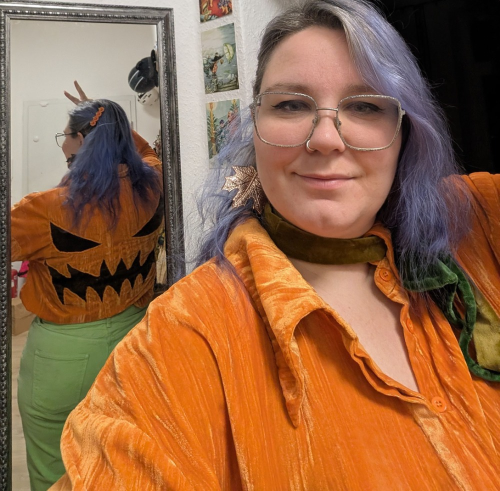
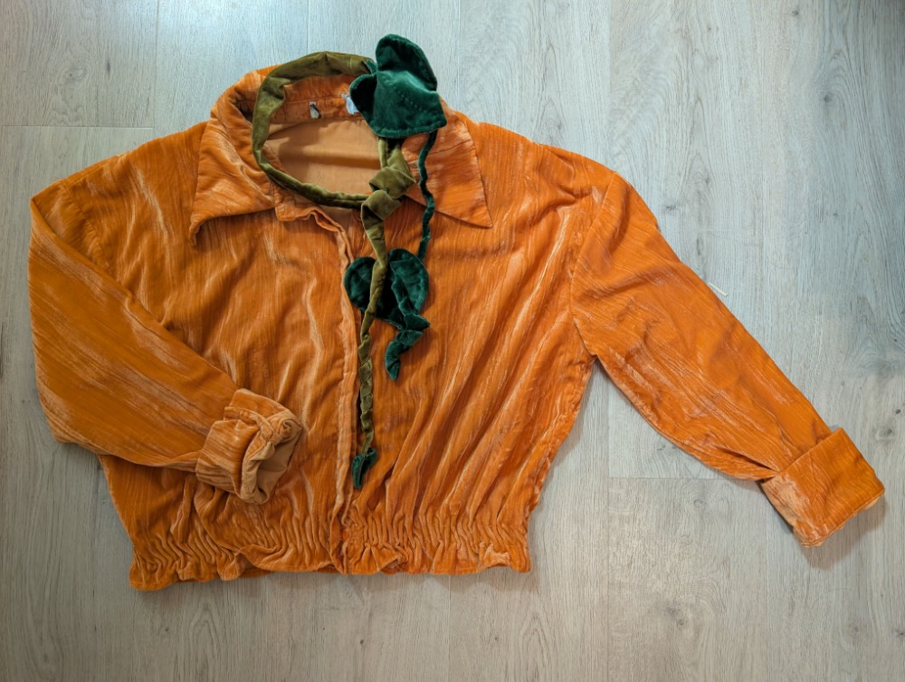
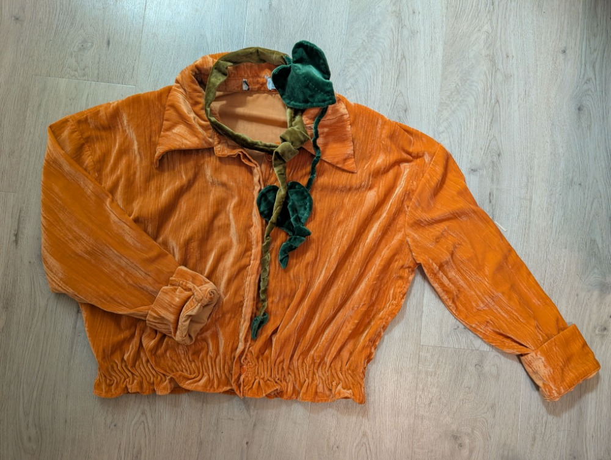
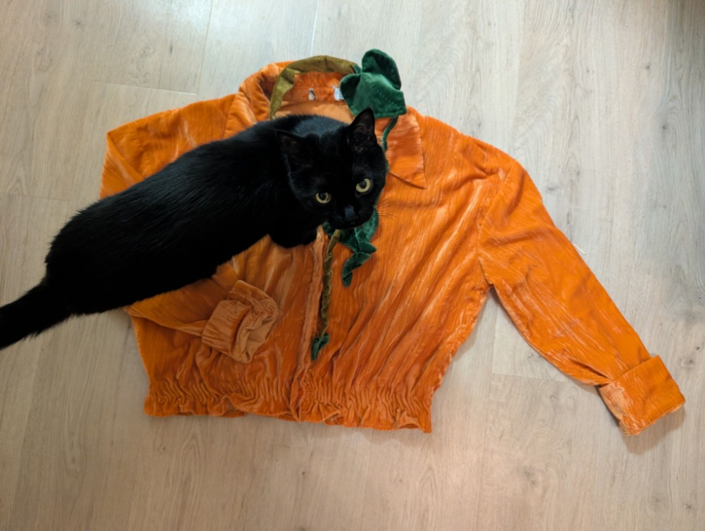
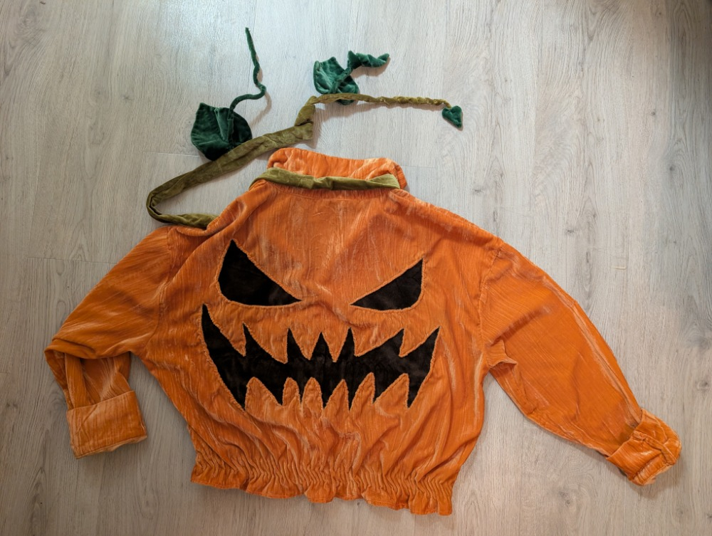
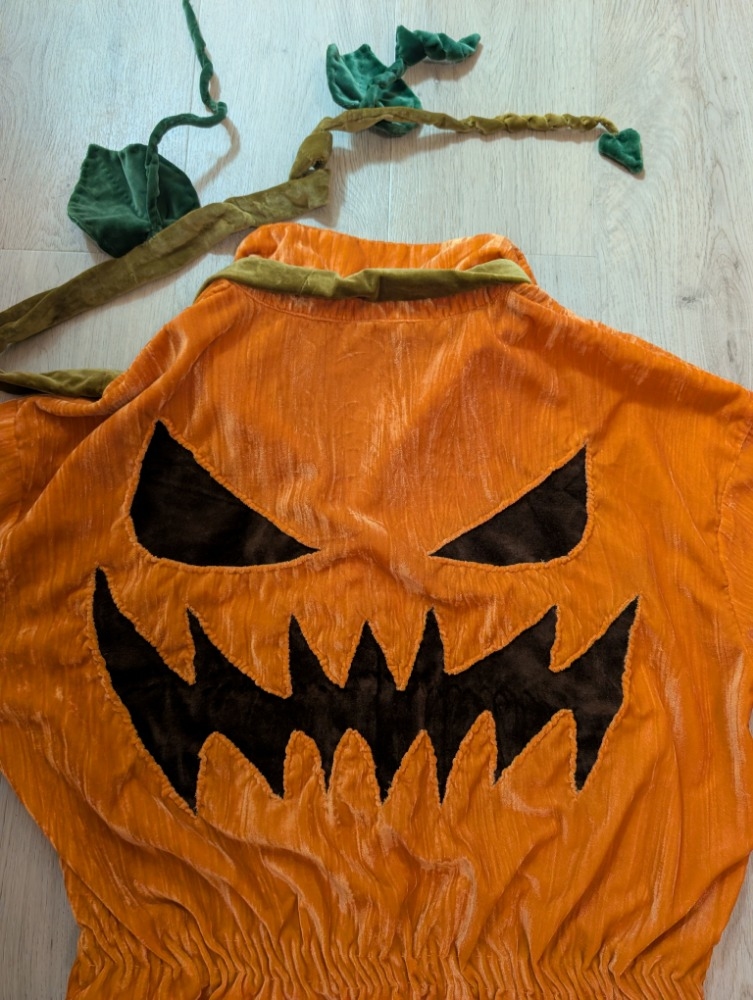
