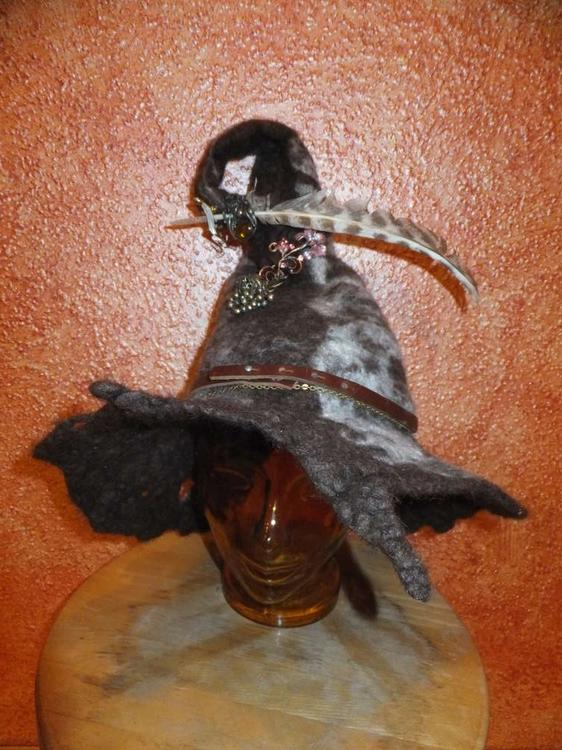
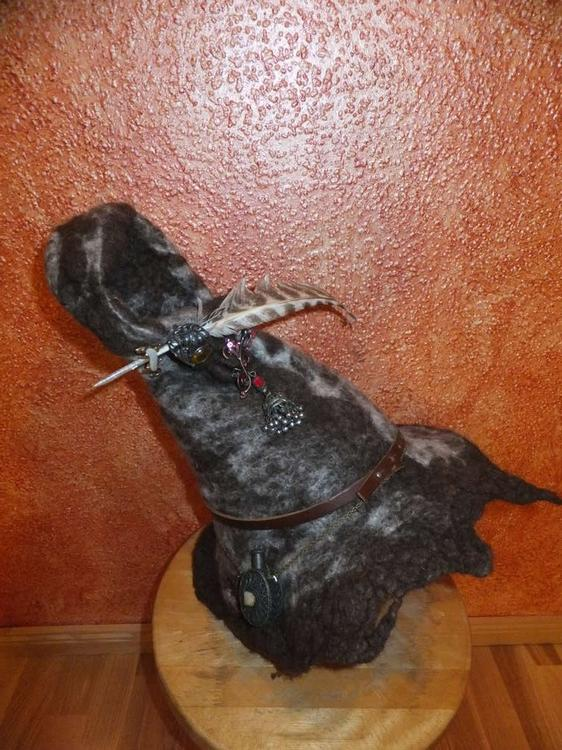
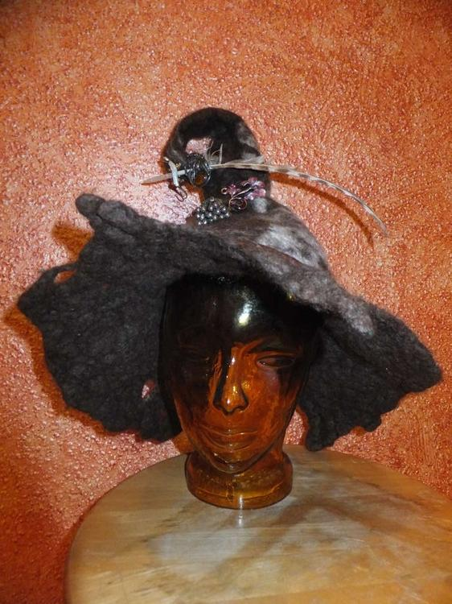
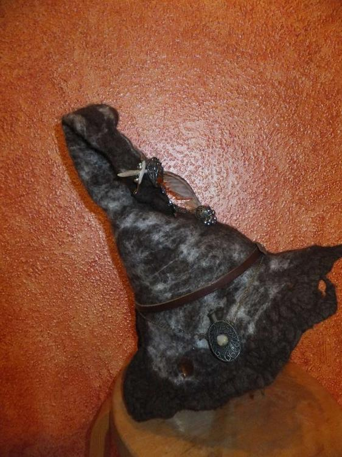
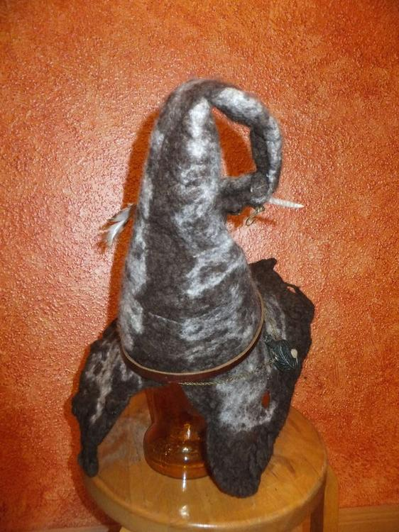

Also ich habe mich vorher noch nie an das Filzen herangetraut und dann kam es über mich: zu viel freie Zeit und der Wille einen qualitativ hochwertigen Hexenhut zu haben, wie ich ihn mir immer vorgestellt habe.

Die wahre Auslöser warum ich überhaupt zum Filzen kam, ist mein Partner (damals noch in der Datingphase), der mich damals aufgrund meiner mannigfaltigen Hobbies fragte, ob ich auch Filzen kann. 
"Klar!" Hab ich geschrieben und mich im gleichen Moment über mein großes Mundwerk geärgert. Gefilzt hatte ich zu diesem Zeitpunkt noch nie. Ich hatte es lediglich irgendwann mal vor. 

Also nimmt man was man hat und schaut was draus wird. Hier habe ich kratzige Wolle, Spüli und Unwissenheit zusammengetan und voila.

Ich hielt mich an die Anleitung von meinem Buch. Ich wusste es nicht besser und nahm die Schafswolle vom Flohmarkt, die ich noch hatte, sie war zwar schon gewaschen aber von der falschen Sorte, staubtrocken, brüchig und sehr widerspenstig. Nachdem ich mehrere Stunden per Hand gefiltz hatte, war meine Enttäuschung groß, die Hände schrumplig und die Knie wund (ich filzte auf dem Boden...). Der Hut wollte sich einfach nicht verfilzen lassen und er war viel zu groß... 

Der Frust war groß. Die Wolle wollte nicht wie ich, ließ sich von Hand gerade so störrisch anfilzen und ich schmiss im wahrsten Sinne des Wortes hin. Ich resignierte und warf das bisher nur angefilzte Stück in die Waschmaschine, denn schlimmer konnte es nicht mehr werden.

Ich dachte im besten Fall an ein gefilztes Etwas, was ich dann eventuell noch anderweitig verwursten könnte. 
Umso überraschter war ich, als der Hut, der aus der Wäsche kam, ein ziemlich interessantes und individuelles Teil war.
Und siehe da, die Waschmaschine erschuf etwas einzigartiges, was ich sehr lieben gelernt habe. 

Da ich über diese Umwege auch zum LARPen gekommen bin, wusste ich, dass der Hut was geworden ist, was ich für meinen Charakter nutzen wollte - eine junge, leicht wollhysterische, verschrobene Hexe, angelehnt an das Scheibenwelt-Universum

Als der Hut auch noch wie für meinen Kopf geschaffen schien, hat er mein Herz im Fluge erobert. Hinten hat die Krempe zwar einen Riss, aber dann kann ich wenigstens einen Zopf tragen... :) 
Mit ein bisschen Klimperkram Federn und Gedöns, ist der Hut von der Ermeline Wollknoll entstanden, die heute diesen Blog belebt.
