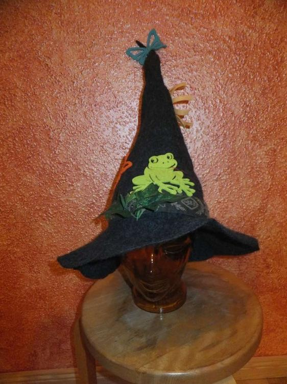
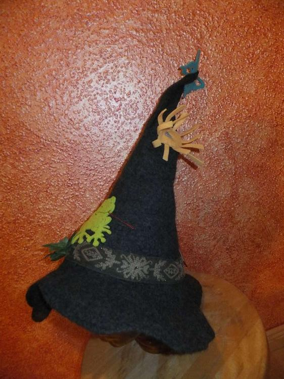
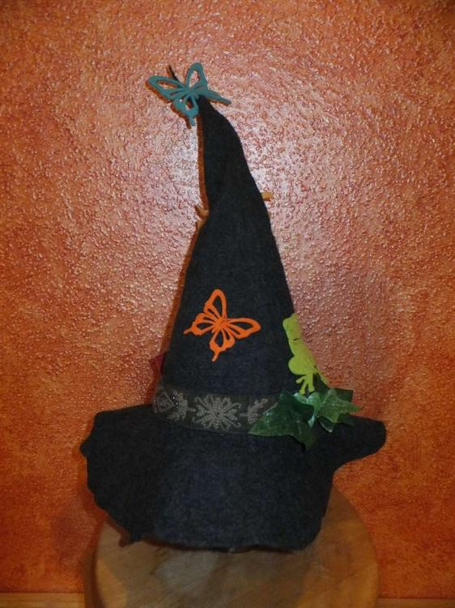
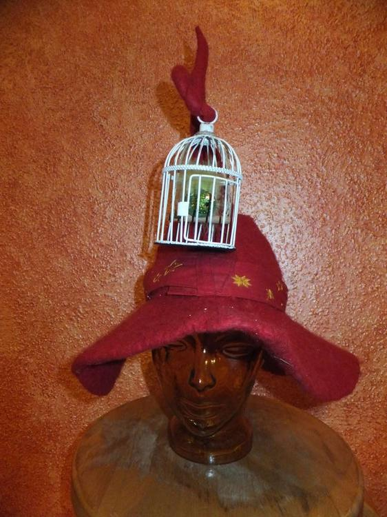
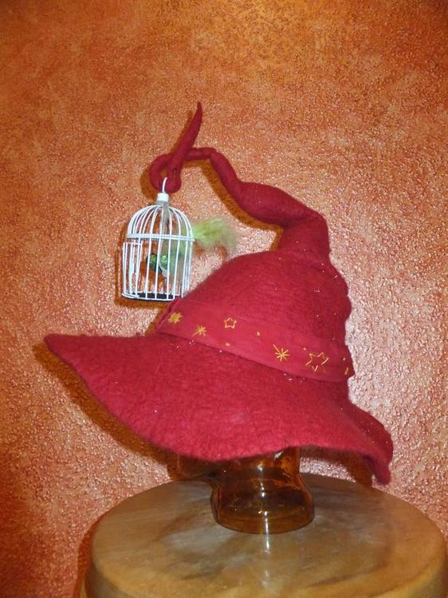
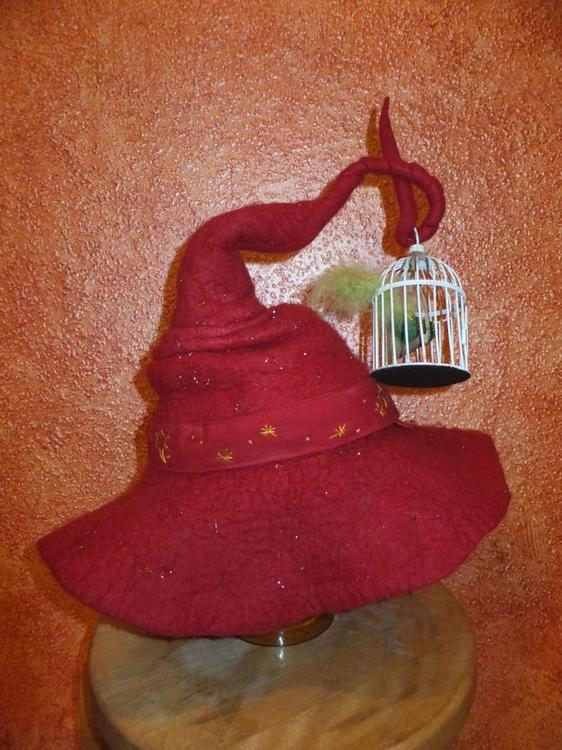
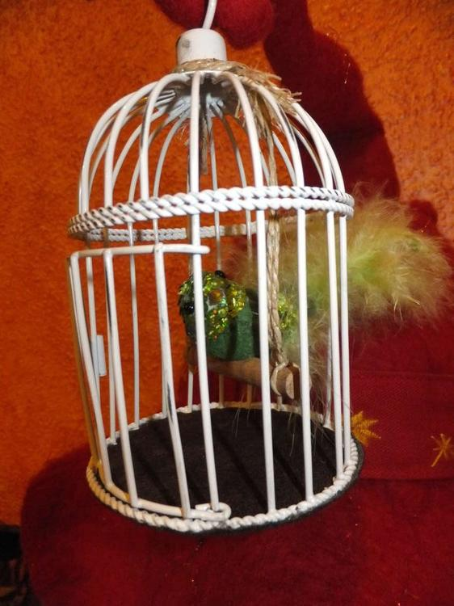

Tja, wo ein [Hut](/2014/01/mein-erster-filzhut) was geworden ist, ist der zweite Hut nicht weit. Jetzt wollte mein (inzwischen) Freund für seinen Magier-Charakter auch einen haben... Schließlich war er doch der Initiator dieser Reise. 

Wer kennt die Scheibenwelt von Terry Pratchett? Er hat sich einen recht Rincewind-ähnlichen Charakter gebastelt und ein Magier ist nichts ohne seinen Hut. Das Resultat unserer vereinten Filzversuche war ein schlichter jedoch recht ansehnlicher anthrazitfarbener Magierhut, welchen wir jedoch bald gegen Nr.3 ersetzt haben. Nun dient uns dieser noch als Oberhexenhut für die Walpurgisnacht. 

Aber ein Rincewond braucht einen richtigen Hut und so ist der rote Zaubberer zu seinem Hut gekommen.

Der dritte Hut ist ein Meisterstück, vor allem wenn man bedenkt, dass da noch keine große Erfahrung mitgewalkt hat. Acht Lagen Merinowolle mit Glitzerfäden und einem eingenähten Drahtgestell um Form und Vogelkäfig zu halten. 

Hiesige Larper kennen den dazugehörigen Charakter als Ehrlich B. Standen Zaubberer der unsichtbaren Universität zu Ankh Morpork. Der Schachtvogel (angelehnt an die Schachtvögel aus dem Bergbau) vorne an seinem Hut, hört auf zu zwitschern wenn er in Gefahr ist. 
Der arme Vogel hat schon seit langer Zeit nicht mehr gezwitschert, eigentlich seit dem Tag an dem er zu Ehrlich kam. 

Ein wahrer Balanceakt, aber das wird für die Blicke und Kommentare in Kauf genommen... oder was würdest du sagen, wenn dir ein Magier mit dem Hut begegnen würde, der nur Schabernack im Sinn hat?
