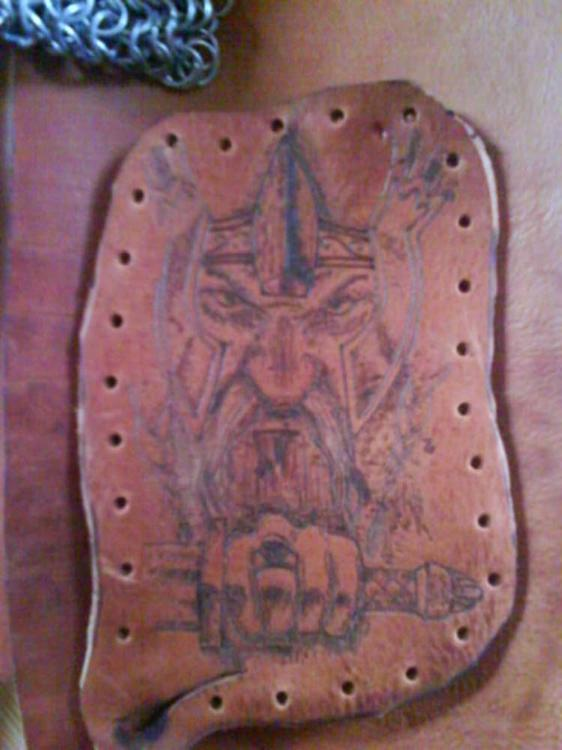
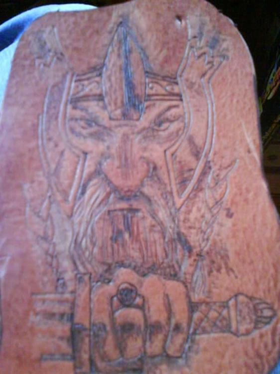

Nachdem ich festgestellt hatte, was man mit Vaddis Lötkolben alles anstellen kann, hab ich mich an das erste Lederbranding rangewagt. Man was braucht man da Feingefühl. 
So muss sich ein Tätowierer fühlen. Das ist natürlich auch nicht so detailliert wie auf der Vorlage aber trotzdem ganz ok. Blöd nur, wenn man noch nicht so richtig auf der Schippe hat, dass ein Lötkolben heiß ist...  

Und ich kann nicht empfehlen die Lötspitzen zu verwenden mit denen man nochmal löten möchte. Durch das Verbrennen des Leders, kann später beim Löten die Temperatur nicht mehr so gut in die Spitze gelangen um das Lötzinn zu schmelzen. Benutzt also nur sowieso schon alte Spitzen oder holt euch einen Brennkolben mit dem auch Holzbrandings gemacht werden können. 

Ich habe den Lötkolben mit der Erlaubnis meines Vaters verwendet, aber kurz danach bekam ich zufällig einen eigenen Holzbrennkolben geschenkt. Zufall?